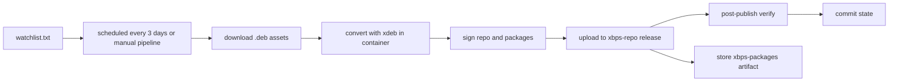

# debport

[](https://dl.circleci.com/status-badge/redirect/gh/bagaskara815/debport/tree/master)
[](https://github.com/bagaskara815/debport/releases/tag/xbps-repo)

A CircleCI-only tool that converts upstream `.deb` packages to Void Linux
`.xbps` packages and publishes them as an installable xbps repository.

There is no local CLI. Everything runs in CI.

## How it works



A scheduled CircleCI pipeline polls the watchlist every 3 days. When a source
publishes something new, the matching `.deb` assets are downloaded, converted to
`.xbps` with [xdeb](https://github.com/xdeb-org/xdeb) inside the
`ghcr.io/void-linux/void-buildroot-glibc` container, RSA-signed, and uploaded
to the `xbps-repo` release of **this** repository. That release doubles as a
remote xbps repository, so converted apps install like any Void package.
Converted packages are also stored as a pipeline artifact.

## Quick start

Register this repo once, then install and update as usual:

```sh
echo "repository=https://github.com/bagaskara815/debport/releases/download/xbps-repo" | sudo tee /etc/xbps.d/debport.conf
sudo xbps-install -Syu
sudo xbps-install -S helium-bin
```

> The first sync prompts to import the repository signing key. Answer **Y**.
> After that, `sudo xbps-install -Syu` keeps converted apps updated together
> with the rest of the system.

Packages are downloaded over the `releases/download` URL, RSA-signed, and
their shlib dependencies resolve against the official Void `current` repo,
so nothing extra is needed on the client side.

## Adding a source

Add one line to [`watchlist.txt`](watchlist.txt):

```
<source>|<asset glob>|<extra xdeb flags>
```

| Source form | Example | Update detection |
| --- | --- | --- |
| GitHub releases (`owner/repo`) | `imputnet/helium-linux\|*_amd64.deb\|` | latest release tag |
| HTTP directory pool (ends in `/`) | `https://rpm.librewolf.net/pool/\|librewolf-*x86_64-deb.deb\|` | newest matching filename (version sort) |
| Direct `.deb` link | `https://example.com/dist/foo_1.2_amd64.deb\|*\|` | the URL itself (re-runs when the URL changes) |

Rules:

- **Glob is required** and must select x86_64/amd64 debs only. The runner is
  x86_64; `xbps-rindex` silently drops other architectures.
- Extra flags are whitespace-separated xdeb options appended to `-Sedf`
  (no spaces inside a flag value), e.g. `--not-deps=musl`.
- `.deb` filenames may follow any convention: package names are read from the
  deb control data, not the filename.

## Running

| Trigger | How |
| --- | --- |
| Scheduled | CircleCI schedule trigger `0 0 */3 * *` (UTC) on `master`. Upstream repos cannot webhook here, so polling is the only trigger. |
| Manual | CircleCI → *Trigger Pipeline*: `repo` scopes the run to one watchlist entry (empty = all), `force` reconverts even when the tag is already recorded in `state/`. |

Runs write `state/<source>.txt` with the converted revision and commit it back
to the repo, so unchanged entries are cheaply skipped on the next run.

## Repository layout

```
.circleci/config.yml            # 3-day schedule (00:00 UTC = 07:00 WIB), pipeline parameters, artifacts
scripts/convert.sh              # runs INSIDE the container: installs missing tools,
                                # converts each .deb with xdeb, asserts output + repodata,
                                # records a manifest, signs repo + packages with XBPS_PRIVKEY
scripts/run.sh                  # machine-side orchestrator: poll, download, seed repodata,
                                # convert in container, publish, verify, record state
watchlist.txt                   # sources to poll
state/                          # last converted revision per source (committed by CI)
```

## Requirements

- The repository must be **public** (anonymous fetch of the release assets).
- The project must be set up on CircleCI with a `master` branch and two
  **project environment variables**:
  - `XBPS_PRIVKEY`: an RSA private key (PEM, or base64 of the PEM) used to sign
    the repository metadata and packages. Without it the pipeline fails fast:
    remote xbps installs require signed `.xbps.sig2` files.
  - `GH_TOKEN`: a GitHub token with write access to this repository (classic
    `repo` scope, or a fine-grained token with *Contents: read and write*).
    It is used for release assets, upstream release lookups, and the state
    commit push.
- The `.circleci/config.yml` job runs on the `machine` executor because
  `docker run -v` mounts are required for the conversion container; it rewrites
  `origin` to an HTTPS token remote before pushing state.

## Design notes

- Results are published as **release assets**, not git blobs: `.xbps` files
  exceed GitHub's 100 MB per-file limit while release assets allow 2 GB.
- Superseded package versions are deleted only after the new package verifies;
  the repodata index always points at the newest version.
- Post-publish verification checks that every served filename matches the
  `pkgver.arch.xbps` convention, that the served repodata is byte-identical to
  the one just uploaded, and resolves each package against the real release URL
  plus the official Void repo before recording state.
